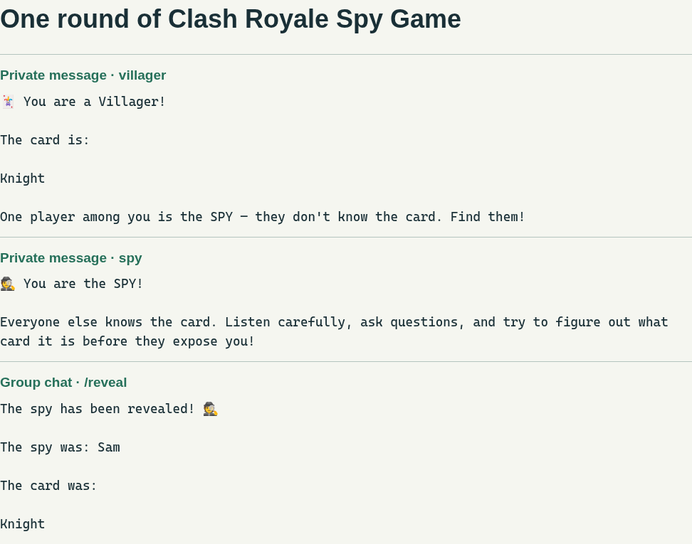

# Spy Game for Telegram

## Private roles and the group reveal

Start the bot privately with /start so it can send you a role. In the group, the host sends /newgame, selects Clash Royale, Dota 2 or Valorant, and starts once at least two players have joined. One player becomes the spy. Everyone else receives the same card, hero or agent. Compare clues in the group and use /reveal to show the answer.



The example renders the bot’s English message templates with Knight as the card and Sam as the spy.

### Run the bot

Install the dependencies, copy .env.example to .env and set BOT_TOKEN. Start polling from the repository root.

```sh
python -m pip install -r requirements.txt
python bot.py
```
