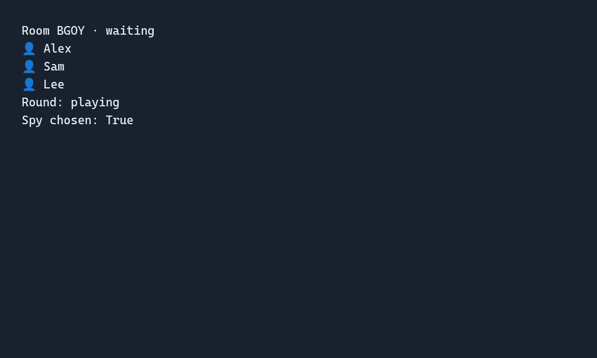

# clashroyale

## Play a round

A Telegram party game for a group chat. Everyone except the spy receives the same secret subject from Clash Royale, Dota, or Valorant. Install the dependencies, copy .env.example to .env, set BOT_TOKEN to your bot token, and start the bot.

```sh
python -m pip install -r requirements.txt
python bot.py
```

Each player opens a private chat with the bot and sends /start. In the group, the host sends /newgame, picks a mode, waits for at least two players, then starts the round. Use /reveal to show the spy. The image shows a local three-player run through the room manager.


